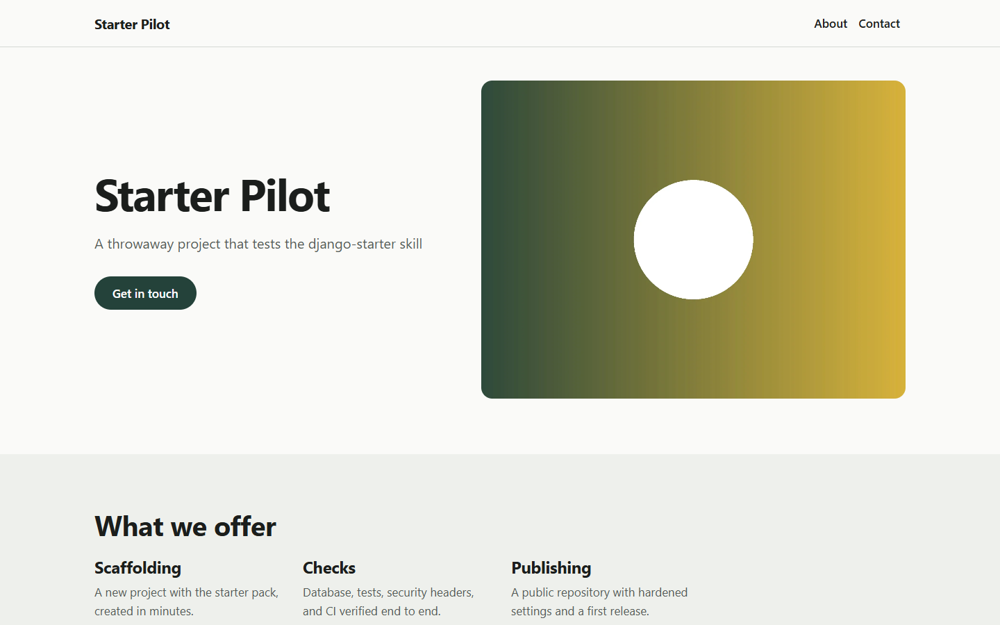

# Starter Pilot

A throwaway project that tests the django-starter skill. It has no real business or customers
and is deleted after the test.

## What the website does

- **Public website**: the business's pages, with contact details on every page.
- **Features included**: Website, CRM.
- **Administration** for the owner and staff, protected by a password, a lockout after repeated
  wrong passwords, and a code from an authenticator app when customer data is stored.

## How the owner uses it

1. Open the administration (link "Staff sign in" at the bottom of every page).
2. Sign in, then enter the code from your authenticator app.
3. Work with the features listed above.

## What still needs the owner's input

- Business name, contact details, and opening hours.
- Texts and photos for each page.
- The privacy policy and terms of use (drafts to review, ideally with a legal professional).

## Security and privacy

Every page is served over an encrypted connection, the site loads nothing from other websites,
and customer data stays in the business's own database. Technical details:
[docs/security/CONTROLS.md](docs/security/CONTROLS.md).

## Next steps

- Publish the website on a hosting service and connect the business's domain.

## For developers

Setup, configuration, and tests: [docs/DEVELOPER.md](docs/DEVELOPER.md).

## License

The code is under the MIT license. The business's images, logos, and texts are not: all rights reserved.
